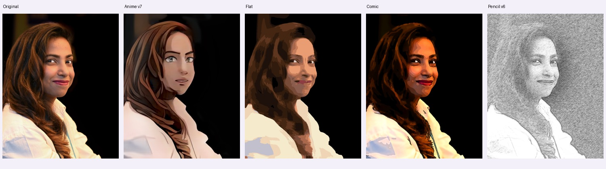

# Cartoonify Studio

Windows 11 / Python 3.12 / 纯 CPU 照片风格化与拼豆图纸。无 CUDA、无训练、无付费 API；图片留在本机，启动后处理不联网。四种风格分别采用人像动漫模型、区域插画、印刷漫画和分层铅笔素描路线。



## 当前版本

本轮增强动漫人像：默认 **Webtoon 动漫增强**，可切换 **FacePaint v2 柔和插画**。加入头部裁切、眼睛水平对齐、渐变拼接与有限肤色约束；纯 CPU、无训练、启动后不联网。另三种风格与拼豆沿用已验证版本。

查看 [21 张动漫新旧对照](outputs/anime_v7/gallery.html)、[模型筛选、CPU 性能与局限](anime_v7_report.md)。完整测试 111 项通过，双模型网页预览、原尺寸 PNG/JPG、批量 ZIP 已实际验证。强动漫可能改变人物特征、年龄感和肤色；高清文件尺寸不等于恢复真实细节。

素描保留 [v6 变宽笔触](outputs/pencil_v6/gallery.html) 和 [CPU 报告](pencil_v6_report.md)。历史动漫 FacePaint v2 见 [v4 画廊](outputs/v4_review/gallery.html)。

## 安装和启动（Windows PowerShell）

本机项目在 `D:\CartoonifyStudio`。已有环境更新依赖后启动，或双击 `start.bat`：

```powershell
Set-Location D:\CartoonifyStudio
.\.venv\Scripts\python.exe -m pip install -r requirements.txt
.\.venv\Scripts\python.exe app.py
```

新机器安装官方 Python 3.12，再克隆和创建独立环境：

```powershell
Set-Location D:\
git clone https://github.com/hellojean123/CartoonifyStudio.git
Set-Location D:\CartoonifyStudio
py -3.12 -m venv .venv
.\.venv\Scripts\python.exe -m pip install -r requirements.txt
.\.venv\Scripts\python.exe app.py
```

无需激活环境或修改执行策略。默认地址 http://127.0.0.1:7860 ，若占用，以控制台地址为准；关闭控制台停止。仓库已附动漫 ONNX 权重与人脸定位模型，运行时不下载。正常使用只需 ONNX Runtime CPU，**不需要 PyTorch、TensorFlow、GPU 或模型转换依赖**。`requirements-lock.txt` 是运行依赖快照；迁移时重建 `.venv`。

## 使用

1. 拖入 JPG、PNG、WebP，或从内置照片画廊选择样片。
2. 在动漫中选择“动漫增强 / 柔和插画”。选择“动漫人像（双模型）”“扁平插画”“美式漫画”“铅笔素描（变宽笔触）”；切换会加载预设。
3. 松开滑块自动预览，先显示 480 草稿，再显示最长边 1000 的最终预览。动漫草稿跳过脸部局部细化以加快显示，结构/颜色可能不同，最终预览和导出复用同一份分析结果。
4. 调整整体轮廓、主要边缘和内部细线。人像保护减弱脸颊纹理，保留眼鼻嘴区域；手动保护框在“轮廓分层与手动保护”中设置。自动局部重绘仅采用足够大的关键点人脸，最多 3 个头部；手动框可补充局部重绘，但不能保证模型保持身份。
5. 插画调色板 4～48 色；漫画明度 4～12 级，另有网点间距、角度、浓度；素描可调排线浓度、纸张颗粒、彩铅。线条不够时先增加整体轮廓和内部细线，排线控制阴影笔触。
6. 动漫“标准 / 精细”共用相同结构，分别使用线性 / 双三次高清插值，不混回原照片纹理。其他风格隐藏该项并采用相同结构渲染。选择 PNG / JPG 后点击原尺寸导出。
7. 批量页复用当前风格与参数，每张处理后打包 ZIP；单张失败记录原因，成功结果仍可下载。取消在阶段、图块或图片边界生效；正在进行的一次 CPU 模型推理不能在算子中途打断。

重置会恢复预设并清除手动框，下次预览采用恢复值。自动预览只在松开滑块时触发，并只保留最新待处理请求。预览、导出、批量、拼豆共用 CPU 资源队列和应用锁。

## 四种算法与高清限制

| 风格 | 独立处理路线 |
|---|---|
| 动漫人像 | Webtoon（动漫增强）/ FacePaint v2（柔和插画）预训练权重 → ONNX Runtime CPU 重绘 → 头部裁切与眼睛对齐 → 生成图上的轻量轮廓增强；不对照片做全局硬色块量化 |
| 扁平插画 | 双边 + 四区域软权重 Kuwahara → Lab 采样 K-Means → 32³ LUT → 空间投票、小孤岛合并、五官区域标签保留 → 少量主线 |
| 美式漫画 | 区域平滑 → 饱和度增强、明度分级 → 顺结构粗线与浓阴影 → 可调抗锯齿半调网点 |
| 铅笔素描 | 多尺度结构线 → 按人脸亮部自适应明暗 → 曲线、连续压力与亚像素变宽笔触 → 轻笔石墨累积 → 目标尺寸重绘；可选有色吸收 |

动漫增强全图最长边 **512**，头部模型输入 **256**；柔和插画全图 **640**、局部 **512**。自动头部需关键点定位且分析宽高至少 70 像素，手动框至少 50 像素，最多 3 个；边界与身份仍可能变化。传统分析最长边 **1000**。全图动漫模型擅长单人人像，远处小脸和非人像可能偏暗、过度抽象；不会凭空恢复看不清的五官。高清导出按原尺寸分块重建；素描重新绘制同一组笔画路径，不放大预览笔触位图。结构分析、网点与纸纹使用统一坐标，避免分块接缝。高分辨率导出不等于逐像素重新运行动漫模型，也不是超分辨率；线条/笔触仍受分析尺度限制。

输入上限 1600 万像素 / 40 MB / 单边 20000；超过时拒绝。EXIF 方向自动纠正、透明区域铺白、ICC 转 sRGB；导出附 sRGB。解码缓存 64 MiB、中间缓存 112 MiB，模型与输入/结果内存另计。ONNX Runtime 2 线程且只启用 CPUExecutionProvider；OpenCV 2 线程、OpenCL 关闭。改变轮廓和网点可复用中间结果。

## 模型来源

动漫使用 [Bryan Lee 的 animegan2-pytorch](https://github.com/bryandlee/animegan2-pytorch) 中作者提供的 **celeba_distill（Webtoon）** 和 **face_paint_512_v2**，固定提交、原权重 SHA256、转换版本、ONNX 校验和、与原模型数值误差均见 `models/anime_metadata.json` 和 `models/anime_webtoon_metadata.json`。附固定版本仓库的 MIT 许可 `models/LICENSE-FacePaint.txt`。没有使用原 AnimeGAN 的 Paprika / Hayao 等转换权重，也未将其他仓库的许可套用到这里。

人脸定位使用 OpenCV 官方 YuNet 2023 小模型（MIT），CPU 后端，Haar 级联补充；不做人脸识别。来源和 SHA256 在 `models/metadata.json`、`models/LICENSE-YuNet.txt`。五点和肤色门限只是粗区域，可能漏检或误检，不能视为精确语义分割。

`convert_anime_model.py` 提供从固定上游源码与权重重建 ONNX 的开发工具；**仅开发转换**需要另外安装纯 CPU PyTorch 和 ONNX，正常运行不用安装：

```powershell
.\.venv\Scripts\python.exe -m pip install torch==2.9.0 --index-url https://download.pytorch.org/whl/cpu
.\.venv\Scripts\python.exe -m pip install onnx==1.19.1
.\.venv\Scripts\python.exe convert_anime_model.py
```

## 实际测试与画廊

```powershell
Set-Location D:\CartoonifyStudio
.\.venv\Scripts\python.exe -m pytest -q --junitxml=outputs/pencil_v6/pytest.xml
.\.venv\Scripts\python.exe smoke_pencil_v6.py
.\.venv\Scripts\python.exe evaluate_pencil_v6.py
.\.venv\Scripts\python.exe build_gallery.py
Start-Process .\outputs\pencil_v6\gallery.html
Start-Process .\outputs\gallery.html
```

当前完整回归测试 **102 项通过**，覆盖全部四风格、异常文件、透明/灰度、EXIF、极端参数、1×1、CPU 权重校验、缓存、高清接缝、导出、批量、取消与拼豆。新增连续压力与笔宽、叠加不擦除、深浅与粗细独立、目标尺寸重绘和笔画生成一致性检查；保留明暗、人像、彩铅与高清一致性回归。程序正确性不等于审美评审，请查看原图、新旧结果和原始像素局部。

`outputs/pencil_v6/` 保存全部 21 张授权照片的原尺寸素描和彩铅，以及新旧、OpenCV 对照和裁剪坐标。`outputs/4_铅笔素描/` 和全部五联图已更新；其他三种风格的 63 张输出保持原哈希。真实高清结果为 `outputs/highres_4.png`（3840×2880）。计时、RSS 内存和网页实测见 `pencil_v6_report.md` 及该目录的原始 JSON。

新旧对照需要完整 Git 历史中的 `664a749ca0a39b89aa233279e72aaac552b460a5` 提交，应用运行不需要历史。比较使用已发布的图像，不依赖本地备份。

`benchmark.md`、`benchmark_v3.md`、`benchmark_v4.md`、各轮重做报告和 v2/v3/v4 画廊为历史记录。当前素描只看 v6；其他三种风格沿用 v4。v5 素描画廊和报告也保留为历史记录。旧评估脚本在当前代码上运行会调用当前算法，不能据此冒称重新测得旧版。

## 照片授权、目录与迁移

正式照片的来源、作者、许可和下载日期见 `samples/metadata.json` 与 `samples/ATTRIBUTION.md`；真实高清参考单列于 `samples/high_resolution`。仅接受可修改再分发的 CC0 / 公有领域 / CC BY / CC BY-SA / OGL 等已核实来源，排除 NC、ND 和不明来源。再分发、改编继续保留署名及适用的相同方式共享条款；人物仅为演示，不表示背书。失败候选不计入正式样本。

- `cartoonify/core.py`：独立处理管线、保护区域和分块渲染。
- `cartoonify/anime.py`、`cartoonify/npr.py`、`cartoonify/pencil.py`、`cartoonify/strokes.py`：CPU 动漫、区域处理、独立素描明暗与连续压力画笔。
- `cartoonify/service.py`、`cache.py`：导出、取消、资源锁和有上限的缓存。
- `models/`：本地权重、来源校验、许可；`tests/`：回归测试。
- `outputs/1_经典卡通/`：动漫结果；沿用内部键与目录名以保持 API 兼容。
- `outputs/2_扁平插画/`、`3_美式漫画/`、`4_铅笔素描/`：其他三风格结果。
- `outputs/pencil_v6/gallery.html`：当前素描核验；`outputs/v4_review/gallery.html`：历史 v4 核验；`outputs/exports/`：用户导出文件。

仓库不包含虚拟环境、Python 安装包、缓存和整套备份。克隆/迁移后重建 `.venv`，勿复制旧环境或覆盖其他项目目录。原有拼豆功能与照片四风格独立，说明如下。

## 照片转拼豆图纸

上方上传原照片，再切换“拼豆图纸”页，点击“生成 / 更新拼豆图纸”。算法独立于卡通四风格，直接从原照片生成网格，避免卡通碎线再次被量化成杂色。

- 默认“人像清晰”：96 格 / 18 色 / 轻度平滑 / 3 粒，保留五官和面部明暗。另有轻松拼 72 格 / 10 色 / 5 粒、均衡 96 格 / 16 色 / 3 粒、保留细节 128 格 / 24 色 / 1 粒。人像预设增加格数和颜色，会增加用量。
- 网格保持照片比例，最长边可调 16～160 格；每格一粒豆，所有格子都计入用量，白色也不是空白。
- 使用浮点 CIELab 量化、无抖动、相邻颜色聚合与四连通小区域合并，减少孤立杂色。调整“相邻颜色聚合力度”和“合并小于几粒的色块”可控制简洁程度。
- 默认保留眼睛、鼻子、嘴唇的亮暗结构；人脸轻度平滑、优先分配肤色，并降低区域合并强度。这样可能保留少量单粒；关闭该选项可进一步减少碎块。检测失败、非常小的脸仍可能损失五官；可提高格数、用色，降低小块阈值，或先裁剪主体再上传。
- 下载包包含 preview.png、编号 chart.png、矢量 chart.svg、A4 分页 pattern.pdf、colors.csv 用量清单、grid.csv 网格和 pattern.json。同一份网格驱动所有文件，编号 01 对应清单 B01，行列从左上角 1 开始。
- PDF 每页最多 29×29 格，支持 5mm / 2.6mm 格距；按“实际大小 / 100%”打印，用图内 50mm 标尺检查，不启用适应纸张。格距不是熨烫后的成品尺寸。2.6mm 小格的编号较小，可放大阅读。
- 颜色数量是净用量，购买时自行预留余量。自动调色 A01 等只是设计参考，B01 等是本图内编号，都不代表任何品牌的实体豆色号。

要使用自己的实体豆，选择“使用实体色卡 CSV”，上传 UTF-8 CSV，列为 `code,r,g,b`，可增加 `name`。最多 256 条色卡颜色，最终使用不超过滑块指定数量，只使用导入色卡的 RGB；不会编造品牌色号。示例 `palettes/example.csv` 全部是 EXAMPLE 颜色，不是实际品牌色卡。屏幕颜色与实物受光照影响，仍应核对实体色卡。含非 ASCII 色号的完整信息保存在 CSV / JSON 中；PDF 用本地编号对应，便于跨系统打印。

```powershell
Set-Location D:\CartoonifyStudio
.\.venv\Scripts\python.exe -m pip install -r requirements.txt
.\.venv\Scripts\python.exe app.py
.\.venv\Scripts\python.exe evaluate_beads.py
.\.venv\Scripts\python.exe benchmark_beads.py
.\.venv\Scripts\python.exe smoke_beads.py
Start-Process .\outputs\beads\gallery.html
```

21 张真实样片均已生成拼豆图纸与对比，见 `outputs/beads/gallery.html`；算法与实测报告见 `beads_report.md`。原照片作者、许可在画廊及示例包 SOURCE.txt 中保留，改编结果继续遵守原照片授权。

面部细节专项：`bead_face_report.md`；原图 / 旧版 / 同格数同颜色新算法 / 新人像预设对照见 `outputs/beads_face_v2/gallery.html`。低层 `BeadParams()` 保持旧的 72 格/10 色默认，UI 和正式样例使用人像清晰预设。


## 铅笔笔触 v6：细重、宽浅与轻笔叠加

- 选择“铅笔素描（变宽笔触）”。以细笔为主，粗细与浓淡分别变化；暗部通过多次轻画累积。压力有多种起收笔轮廓，不是统一的三段深浅。
- “铅笔明暗与排线浓度”控制整体铺调子和笔触深浅；0 为纯结构线。纸纹和轮廓滑块可单独调整。彩铅在白纸上形成有色笔触。
- 高清导出按目标尺寸重新绘制曲线路径，耗时比旧版放大位图更长；不超过 150 万像素的目标可在现有 112 MiB 中间缓存内保留笔触场，调参数时复用。
- 面部结构仍由最长边 1000 的分析图决定。笔触重绘不能恢复看不清的五官，复杂背景仍可能排线偏密；这仍是程序化绘画。
- [单笔、粗细浓淡与重复轻画样张](outputs/pencil_v6/brush_sheet.png) · [21 张新旧对照和局部](outputs/pencil_v6/gallery.html) · [CPU 实测与局限](pencil_v6_report.md)。

```powershell
Set-Location D:\CartoonifyStudio
.\.venv\Scripts\python.exe brush_sheet_v6.py
.\.venv\Scripts\python.exe evaluate_pencil_v6.py
.\.venv\Scripts\python.exe -m pytest -q
```

实现参考已有画笔引擎的压力、变宽和材料累积思想，未移植第三方引擎或引入新依赖、训练、GPU、付费 API。原尺寸输出、彩铅、PNG/JPG、批量及拼豆继续可用。

重建 Webtoon 权重时，在模型转换命令后加 `--model webtoon`；正常使用不需要重建。开发依赖应装在单独环境。
