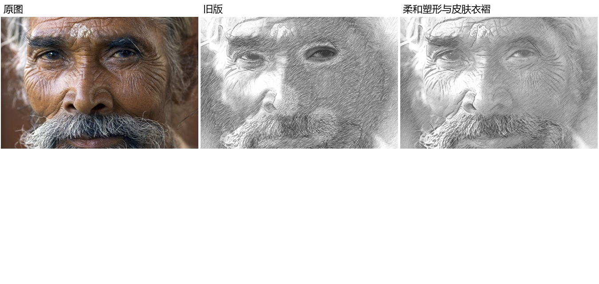
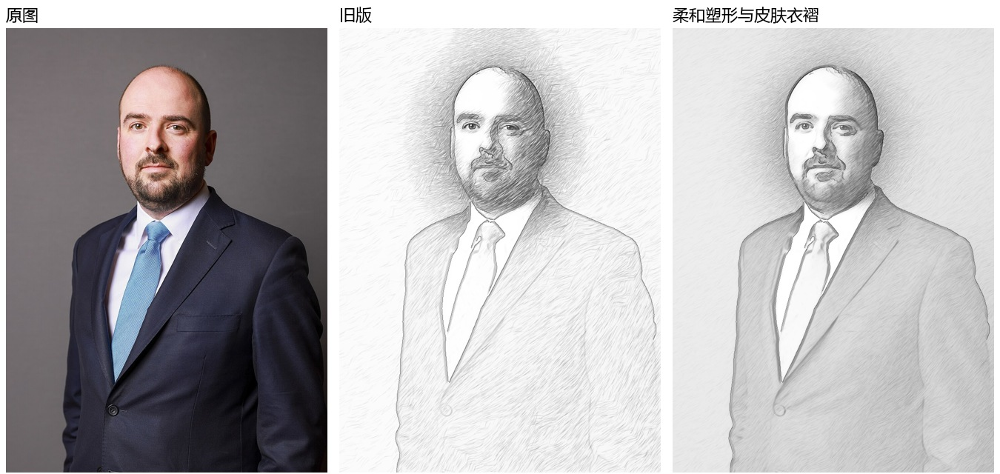

# Cartoonify Studio 素描改进实验报告

## 1. 实验结论与范围

本报告整理素描 v11 至 v14 的改进思路，重点记录当前 v14 的验证结果。当前算法在 CPU 上完成轮廓、连续明暗、多轮笔触、眼部融合及皮肤/衣褶纹路处理，不新增训练、权重或付费 API。

工程验证通过，已有142项完整测试及33张样本对照。目视检查表明，衣服明暗与部分过渡较前版连贯；但老人深眼窝仍欠清晰，皮肤细纹的取舍、排线密度和眼部自然程度尚不稳定。因此本报告不将测试通过等同于画质达标，也不声称已达到专业画师效果。

报告整理及仓库核验日期：**2026-11-13（Asia/Shanghai）**。所引用的算法评估、pytest、HTTP与性能数据来自**2026-11-12**保存的实验记录。本次未重新跑完整算法评估或性能基准；进行了远端提交、源码哈希和99个对照图文件的完整性核验。

算法基准提交：[`50b1e40104074c14e95b7e14d8a605d97560e4fd`](https://github.com/hellojean123/CartoonifyStudio/commit/50b1e40104074c14e95b7e14d8a605d97560e4fd)。核验时该提交已在远端 main，工作区干净；六个关键源码文件均与 verification.json 中的SHA256一致。此报告以独立文档提交并入main，算法源码没有随文档改动。

## 2. 实验目标

| 用户反馈 | 改进目标 | 当前方法及边界 |
| --- | --- | --- |
| 素描像纹理滤镜 | 从整体轮廓和明暗出发逐轮细化 | 四轮局部正残差反馈；仍是笔触空间近似 |
| 眼睛增强生硬 | 保留结构同时消除贴片边界 | 高斯软权重、连续曝光可信度和有限局部对比；没有精确眼睑/虹膜分割 |
| 老人皮肤缺少刻画 | 保留有结构的皱纹，压低无意义噪点 | 多尺度持续暗谷响应；可能漏检细纹或误检毛发 |
| 衣服没有体积 | 区分宽衣褶和细纹，保留整体明暗 | 保边明暗底层与较宽尺度谷线；没有衣料语义识别 |
| 区域与过渡僵硬 | 减少笔触长度、方向和落笔范围的硬切换 | 连续方向混合、端点缩短与软概率控制 |

## 3. 参考依据与算法

### 3.1 绘画流程参考

- [Proko：Practical Guide to Realistic Shading](https://www.proko.com/course-lesson/practical-guide-to-realistic-shading)：先起形、组织大明暗，再处理阴影和软边。
- [Proko：Finishing Your Drawing](https://www.proko.com/course-lesson/finishing-your-drawing-caricature-final-sketch)：线条轻重以及硬边、软边、消失边的取舍。
- [休斯敦美术馆：Folds in Fabric](https://static.mfah.com/documents/art-activity-folds-in-fabric.16662895016713979054.pdf)：主要褶线先行，逐层加深、柔化与保留亮部。

### 3.2 技术参考与版本演进

| 版本 | 核心机制 | 暴露的问题 |
| --- | --- | --- |
| v11 | 参考[AAAI 2021官方实现](https://github.com/TZYSJTU/Sketch-Generation-with-Drawing-Process-Guided-by-Vector-Flow-and-Grayscale)，ETF方向场、灰度分层和有序笔画 | 量化方向造成块状刻线，排序不改变完整叠加目标 |
| v12 | 参考[Hertzmann多尺度绘制](https://mrl.cs.nyu.edu/publications/painterly98/)与[dualFace整体/局部分工](https://arxiv.org/abs/2104.12297)，轮廓引导与四轮残差 | 通用排线仍会盖住五官，缺少部位处理规则 |
| v13 | 眼部独立细节层、源图亮点和头部弱边缘补强 | 眼部曝光与周边不协调，存在贴片感 |
| v14 | 统一明暗底层、多尺度皮肤/衣褶响应、眼部软融合和连续塑形 | 自然程度仍不稳定，细节与柔和度有取舍 |

以上属于工程适配，不是论文原样复现。没有复制新教学图片、付费课程或引入新模型。版本间也有多项参数和机制共同变化，历史画廊属于迭代对照，**不是严格的单因素消融实验**。

### 3.3 当前处理过程

1. 输入纠正方向、透明度和色彩；在统一分析尺度上定位人脸、关键点及软保护区域。
2. 建立轮廓、保边明暗与方向场。平滑明暗承担体积，笔触承担有限纹理与绘画感。
3. 四轮逐渐提高明暗目标、减小笔刷，根据当前画布的欠绘量分配笔画。区域权重连续变化。
4. 在1.2、2.4、4.8三个尺度计算灰度Hessian，提取细长暗谷并要求跨尺度持续，分别侧重细纹和较宽褶皱。
5. 眼部使用较宽高斯影响范围、连续曝光可信度，将全局暗度与有限局部对比混合，减少独立曝光和边界跳变。
6. 原尺寸输出重新栅格化笔触，分块渲染；复用缓存与共享CPU队列。输出尺寸增加不代表恢复真实细节。

这里的“区域”是人脸/肤色软权重、方向与明暗分布，并非精确语义分割。四轮反馈尚未度量最终综合色调的完整误差，也无法主动擦除过深笔迹。

## 4. 数据与实验方法

测试集为33张授权照片，覆盖人物近景、群像、侧脸、暗光、复杂背景，以及风景、建筑和动物。每张当前素描与v13结果、原图构成三列对照；其余三种风格没有在本轮重新计算。

来源、作者、许可和日期见 [samples/metadata.json](samples/metadata.json) 与 [ATTRIBUTION.md](samples/ATTRIBUTION.md)。派生图继续遵守对应照片许可，不能因源码许可证而改变照片许可。

样本为工程便利集，不是随机抽样或独立评审数据集。没有用户盲评、画师评分或真实手绘配对真值；不计算虚构的“审美准确率”。

数据核验包括：完整pytest记录、逐图处理诊断、HTTP导出记录、性能采样文件、源码哈希，以及99个对照图文件的Pillow完整性检查。完整性检查不能替代审美检查。

## 5. 自动化与应用验证

pytest记录：**142通过，0失败，0错误，0跳过**，用时 **107.788秒**。原始记录时间：`2026-11-12T17:05:18.335349+08:00`。

测试覆盖常量区域不制造纹路、皮肤/布料暗谷、眼部软权重、灰度与透明输入、异常文件和参数、取消、缓存、分块接缝、预览导出一致性，以及其他风格与拼豆回归。v14将旧暗光断言从硬回退改为连续低可信度检查；未借此建立画质评分。

| 应用检查 | 已有实测结果 |
| --- | --- |
| 姓名选图与HTTP | 选择成功，HTTP 200 |
| 渐进预览 | 灰度、彩色均返回草稿和最终预览 |
| 灰度导出 | PNG，1180×1600，验证尺寸、ICC与非空内容 |
| 彩色导出 | JPG，1180×1600，验证尺寸、ICC与非空内容 |
| 批量 | 双图ZIP包含2张PNG |
| 取消 | 接口可调用；该次返回“没有正在运行的任务” |

取消接口这次响应不证明高负载任务已被真实中断；实际中断逻辑由已有自动化测试覆盖，应与手动端到端取消实验区分。

HTTP记录中的首次灰度预览约17.389秒、随后彩色预览约6.751秒，包含草稿、细化、排队和缓存影响；它们不是单次算法冷耗时。

## 6. CPU耗时与内存

全量33张的调用中位数 **6.058秒**，范围 **3.513–11.862秒**。部分评估与测试重叠，不能作为隔离性能结论。

另对同一照片缩放至指定尺寸单独测试；属于处理负载实验，并非原生4K画质评测。冷耗时包含分析与渲染，热预览复用缓存。每个分辨率只有本次单次记录，不能代表统计分布或稳定上限。

| 尺寸 | 冷处理/秒 | 热预览/秒 | 进程采样峰值/MiB | 预览与缩小导出的MAE |
| --- | ---: | ---: | ---: | ---: |
| 640×480 | 4.140 | 0.063 | 120.2 | 0.000 |
| 1920×1080 | 6.312 | 0.886 | 156.4 | 1.040 |
| 3840×2160 | 13.866 | 0.893 | 185.4 | 1.023 |

内存为整个Python进程每10毫秒采样RSS，包含解释器、模型与缓存，可能漏掉短时峰值，不能称为算法独占内存。MAE使用0～255强度，表示尺寸间一致性，不能表示审美质量。

本次核验环境为Windows 11、Python 3.12.10。原始性能文件没有完整固化硬件型号、频率和系统负载，因此不能据此作跨机器或版本速度排名。

## 7. 目视效果与失败案例

| 样例 | 观察 | 仍存在的问题 |
| --- | --- | --- |
| 老人近景01 | 部分皮肤纹路比统一排线更有结构，眼部过渡减弱了贴片边缘 | 深眼窝仍欠清晰；部分皱纹丢失，细节与柔和度未平衡好 |
| 西装人像26 | 衣服的大明暗与主要褶线更连贯 | 不能保证准确区分衣料、图案与真实褶皱 |
| 舒淇35 | 面部与衣服过渡较柔和 | 眼部锐利程度与自然度仍有取舍 |
| 刘亦菲40 | 清晰近景适合检查软融合和头发边缘 | 仍依赖关键点，头发与背景可混淆 |
| 暗光、群像 | 能完成处理 | 不能恢复源图不存在的眼部细节；小脸缺少有效像素 |

检测器只识别灰度几何谷线，不能理解皱纹年龄、皮肤生理结构或布料张力。灰度或特殊光色会影响肤色权重；毛发、图案及背景也可能形成误响应。当前没有充分证据宣称眼睛、皮肤或区域塑形已全面解决。

### 重点对照



老人原照：Jorge Royan，CC BY-SA 3.0；本图为派生素描对照，完整署名见样本记录。



衣服样例的作者与许可见样本署名文件。所有对照可在 [HTML画廊](outputs/pencil_v14/gallery.html) 浏览。

## 8. 复现与原始证据

```powershell
Set-Location D:/CartoonifyStudio
./.venv/Scripts/python.exe -m pytest -q
./.venv/Scripts/python.exe evaluate_pencil_v14.py
./.venv/Scripts/python.exe benchmark_pencil_v14.py
./.venv/Scripts/python.exe smoke_pencil_v14.py
```

评估脚本依赖仓库中已有33张样本和其他风格的输出；重跑会更新当前素描结果，建议先切到自己的实验分支。推理仅需现有CPU依赖。

| 证据 | 内容 |
| --- | --- |
| [pytest.xml](outputs/pencil_v14/pytest.xml) | 142项测试的逐项结果与时间 |
| [evaluation.json](outputs/pencil_v14/evaluation.json) | 33张照片尺寸、耗时、内存、笔画与轮次诊断 |
| [benchmark.json](outputs/pencil_v14/benchmark.json) | 不同尺寸的处理和RSS记录 |
| [http_smoke.json](outputs/pencil_v14/http_smoke.json) | 网站预览与导出响应 |
| [verification.json](outputs/pencil_v14/verification.json) | 算法源码校验值与汇总 |
| [report_audit.json](outputs/pencil_v14/report_audit.json) | 本次仓库/源码/99个对照文件核验 |
| [v14实现说明](pencil_v14_report.md) | 更详细的实现变更与限制 |

## 9. 后续最必要的实验

1. 用老人、暗光、灰白头发和复杂衣褶建立固定失败集，放大检查眼睛和材料细节。
2. 独立开关眼部融合、材质响应、连续塑形和明暗底层，做同参数消融，避免多项改变掩盖真实收益。
3. 对眼部边界跳变、细纹保留与过密笔触建立局部指标，并结合匿名人工成对评价，不能仅凭全图MAE。
4. 固定硬件与空闲负载重复测量冷/热耗时及内存，报告中位数与波动范围。
